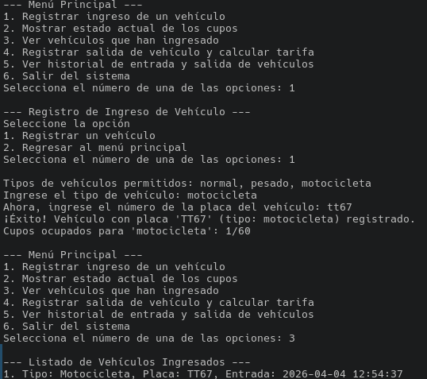

# Gestión de Vehículos


[](LICENSE)


Aplicación de consola para administrar un parqueadero multivehicular (carga pesada, automóviles y motocicletas). Permite gestionar entradas, salidas, cobros y control financiero.

---

## Tabla de Contenidos

- [Características](#características)
- [Estructura del Proyecto](#estructura-del-proyecto)
- [Instalación](#instalación)
- [Uso](#uso)
- [Pruebas](#pruebas)
- [Contribución](#contribución)
- [Licencia](#licencia)
- [Autores](#autores)

---

## Características

- Configuración de tarifas y cupos por tipo de vehículo.
- Registro de entradas y salidas con validaciones.
- Cálculo automático de tarifas y control de cupos.
- Acumulador de pagos y consulta de recaudación diaria.
- Interfaz por consola, sin base de datos (almacenamiento en memoria).

## Estructura del Proyecto

```
├── gestion_vehiculos/   # Código fuente principal
│   └── __init__.py
│   └── README.md
├── tests/               # Pruebas unitarias
│   └── test_ejemplo.py
├── docs/                # Documentación adicional
│   └── README.md
├── requirements.txt     # Dependencias
├── script.py            # Script principal de ejemplo
├── LICENSE              # Licencia MIT
└── README.md            # Este archivo
```

## Instalación

1. Clona el repositorio:
   ```bash
   git clone https://github.com/Louis-Du/Gestion-de-Vehiculos.git
   cd Gestion-de-Vehiculos
   ```
2. Instala las dependencias:
   ```bash
   pip install -r requirements.txt
   ```


## Vista previa

A continuación se muestra cómo se ve el programa en ejecución:



## Uso

Ejecuta el script principal desde la raíz del proyecto:
```bash
python script.py
```

## Pruebas

Para ejecutar las pruebas automatizadas:
```bash
python -m unittest discover tests
```

## Contribución

¡Las contribuciones son bienvenidas! Por favor, abre un issue o pull request para sugerencias o mejoras.

## Licencia

Este proyecto está bajo la licencia MIT. Consulta el archivo [LICENSE](LICENSE) para más detalles.

## Autores

<table>
  <tr>
    <td align="center">
      <a href="https://github.com/eljavi0">
        <br />
        <sub><b>eljavi0</b></sub>
      </a>
    </td>
    <td align="center">
      <a href="https://github.com/Louis-Du">
        <br />
        <sub><b>Louis-Du</b></sub>
      </a>
    </td>
    <td align="center">
      <a href="https://github.com/lukasa133">
        <br />
        <sub><b>lukasa133</b></sub>
      </a>
    </td>
  </tr>
</table>
